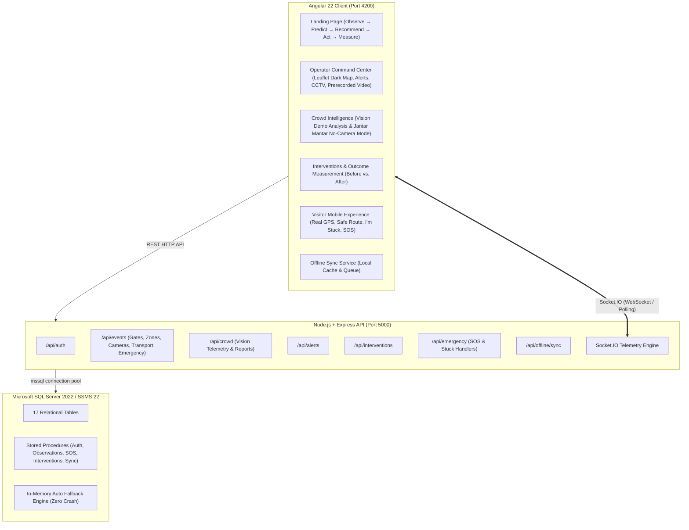

# PRAVAAH — Intelligent Crowd & Event Orchestration

**PRAVAAH** is a mission-critical crowd and event orchestration platform designed for mega-scale public gatherings (e.g., Maha Kumbh Mela, Mumbai Ganpati Visarjan, Jantar Mantar Protests, large-scale stadium events, and concert festivals).

Built from the ground up to reproduce the visual language, information hierarchy, and operational feel of [Mega Event Orchestration Prototype](https://mega-event-orchestration-prototype.vercel.app/), PRAVAAH is implemented exclusively with the user's technology stack:

- **Frontend:** Angular 22, TypeScript, RxJS, Leaflet + OpenStreetMap (with custom dark operational tile filter)
- **Backend:** Node.js, Express.js, TypeScript, Socket.IO
- **Database:** Microsoft SQL Server 2022 / SSMS 22 (schema, seed data, stored procedures, with in-memory resilient fallback)
- **Real-Time Telemetry:** Socket.IO bidirectional event bus

---

## 1. System Architecture



---

## 2. Directory Structure

```
d:/Desktop/AC patil/2/pravaah/
│
├── database/
│   ├── schema.sql           # 17 SQL Server 2022 tables with foreign keys and indexes
│   ├── seed.sql             # 7 Mega Events, zones, gates, cameras, transport, emergency points
│   └── procedures.sql       # Stored procedures for Auth, SOS, Crowd, Interventions, Sync
│
├── node-api/
│   ├── src/
│   │   ├── config/db.ts     # SQL Server 2022 connection manager + resilient mock repository
│   │   ├── data/mockData.ts # Initial event and geospatial seed data
│   │   ├── routes/          # Express API route modules (auth, events, crowd, alerts, etc.)
│   │   ├── socket/index.ts  # Socket.IO telemetry and broadcast engine
│   │   ├── types/index.ts   # TypeScript domain interfaces
│   │   └── server.ts        # Express application entry point
│   ├── package.json
│   └── tsconfig.json
│
├── frontend/
│   ├── src/
│   │   ├── app/
│   │   │   ├── models/      # Strongly-typed frontend data contracts
│   │   │   ├── services/    # Socket, Auth, Geolocation, Offline, Event state services
│   │   │   ├── pages/
│   │   │   │   ├── landing/       # High-fidelity hero & pipeline stepper
│   │   │   │   ├── login/         # Operator vs. Visitor dual authentication
│   │   │   │   ├── operator/      # Command center, demand, crowd, interventions, reports
│   │   │   │   └── visitor/       # Mobile live map, safe route, I'm Stuck, SOS, profile
│   │   │   ├── app.routes.ts
│   │   │   ├── app.ts
│   │   │   └── app.html
│   │   └── styles.css       # Complete dark operational design tokens & Leaflet tile filters
│   ├── angular.json
│   ├── package.json
│   └── tsconfig.json
│
├── .env.example             # Environment configuration template
├── docker-compose.yml       # Production/demo multi-container compose file
└── README.md                # Comprehensive documentation and run guide
```

---

## 3. Key Feature Implementations

| Feature | Implementation Details |
| :--- | :--- |
| **Real Leaflet Map** | Interactive Leaflet v1.9 engine with dark inversion filter, OpenStreetMap attribution, zone polygons, gate markers, live camera pins, transport hubs, and emergency posts. |
| **Prerecorded Event Video** | Explicitly separated from live cameras and vision feeds. Features interactive controls (Play/Pause, Mute, Fullscreen, Progress bar) with the `RECORDED EVENT VIDEO` tag. |
| **Live CCTV Monitoring** | Grid of 3 live simulated CCTV cameras (`CAM-07 Main Ghat`, `CAM-03 Sangam North`, `CAM-12 Pontoon Bridge 2`). |
| **Crowd Video Analysis Studio** | Operator video analysis interface labeled `DEMO ANALYSIS` with frame-by-frame telemetry (density, movement direction, flow rate). |
| **Jantar Mantar Mode** | Camera-less operational mode for sensitive demonstrations. Displays `NO LIVE CROWD DATA` banner with manual operator crowd estimate inputs. |
| **Live Alerts & Rerouting** | Instant Socket.IO push: `CRITICAL CONGESTION: GATE 2` $\rightarrow$ Recommended: `USE GATE 3`. |
| **Safe Route Calculation** | Dynamic routing on Leaflet map that circumvents congested gates and danger zones. |
| **"I'M STUCK" Quick Actions** | Visitor emergency modal with 5 quick response options: *Find Safe Place*, *Medical Help*, *Police / Help*, *Share Location*, and *SOS*. |
| **Emergency SOS Stream** | Real-time broadcast transmitting user coordinates, timestamp, and incident type directly to the operator command board. |
| **Outcome Measurement** | Full closed-loop cycle: **OBSERVE $\rightarrow$ PREDICT $\rightarrow$ RECOMMEND $\rightarrow$ ACT $\rightarrow$ MEASURE** with Before vs. After statistics. |
| **Offline Mode & Sync** | `localStorage` offline caching of map assets, gates, and safety routes with queue synchronization when network restores. |
| **Interactive Demo Mode** | One-click simulation bar allowing operators to test demand spikes, gate congestion, alert dispatches, and interventions. |

---

## 4. How to Run Locally

### Prerequisites
- Node.js (v18 or higher)
- NPM (v9 or higher)
- Microsoft SQL Server 2022 (Optional: the backend automatically connects if available, or seamlessly falls back to the in-memory engine)

### Step 1: Start Backend API
```powershell
cd "d:\Desktop\AC patil\2\pravaah\node-api"
npm run build
npm start
# API listens at http://localhost:5000
```

### Step 2: Start Angular Frontend
```powershell
cd "d:\Desktop\AC patil\2\pravaah\frontend"
npm start
# Application serves at http://localhost:4200
```

### Step 3: Access Pravaah
- **Landing Page:** [http://localhost:4200/](http://localhost:4200/)
- **Operator Command Center:** [http://localhost:4200/operator](http://localhost:4200/operator)
- **Visitor Live Journey:** [http://localhost:4200/visitor/live](http://localhost:4200/visitor/live)
- **Login:** [http://localhost:4200/login](http://localhost:4200/login) (Credentials: `operator` / `operator123` or `visitor` / `visitor123`)
